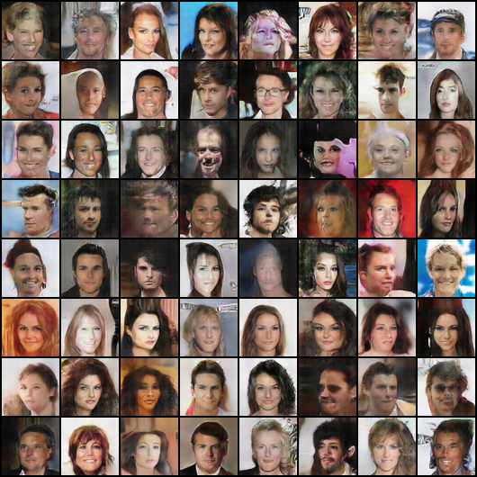
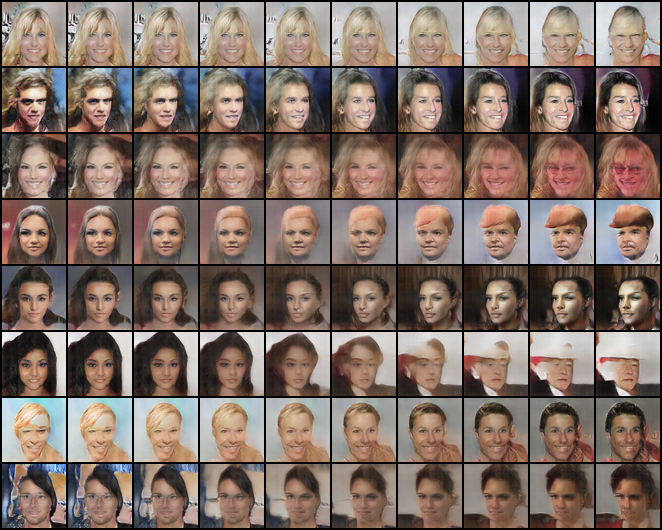

# DCGAN Face Generator

A Deep Convolutional Generative Adversarial Network (DCGAN) implementation. In this project, a generator and a discriminator compete against each other: the discriminator learns to distinguish between real images and fake images, while the generator learns to create increasingly realistic faces of people who do not exist to fool the discriminator.

## Reference
Radford, A., Metz, L., & Chintala, S. (2015). "Unsupervised Representation Learning with Deep Convolutional Generative Adversarial Networks" (arXiv 1511.06434).

## Results





### Summary Table

| Run Name | Change vs Baseline | Epochs | Sec/Epoch | Final LossD | Final LossG | FID |
|---|---|---|---|---|---|---|
| celeba_baseline | Baseline (25 epochs) | 25 | 137.5s | 0.080 | 4.005 | 29.85 |
| base_10ep | Baseline for comparison | 10 | 138.4s | 0.321 | 2.955 | 30.15 |
| exp_nobn | No BatchNorm | 10 | 129.6s | 0.884 | 0.747 | 44.20 |
| exp_lr5e-4 | High LR (5e-4) | 10 | 141.4s | 1.128 | 2.146 | 32.28 |
| exp_beta0.9 | Adam beta1=0.9 | 10 | 140.5s | 0.125 | 7.147 | 148.64 |
| ffhq_baseline | FFHQ dataset | 10 | 35.0s | 0.456 | 3.876 | 94.39 |
| exp_w128 | Wider networks (ngf=128, ndf=128, batch=64) | 10 | 452.5s | 0.182 | 5.291 | 23.95 |
| exp_bs64 | batch size 64, same width as baseline | 10 | 517.1s | 0.118 | 4.708 | 28.75 |

*Note: FID for ffhq_baseline is measured against FFHQ images and is not directly comparable to the CelebA runs.*

### New held-out CelebA comparison

Using the same 182,339-image training split, 20,260-image validation split, batch 64, AMP, seed 42, and evaluation seed 123, the best checkpoints were:

| Run | Width (G/D) | Best epoch | FID on 10,000 validation images | FID on all 20,260 |
|---|---:|---:|---:|---:|
| `celeba_base_bs64_seed42` | 64 / 64 | 10 | 27.05 | 25.63 |
| `celeba_w128_seed42` | 128 / 128 | 20 | **21.98** | **20.68** |

Lower FID is better. The wider model improved full-validation FID by 4.95 in this single-seed matched comparison; it remains a 64×64 DCGAN and can still produce artifacts. These scores are not directly comparable to the historical table above, which used non-held-out images. The two selected checkpoints and evaluation details are in `checkpoints/` (local, gitignored) and `results/celeba_*_eval.json`.

- FFHQ dataset contains 52,001 images.
- exp_w128 changed both the width and the batch size (64), so its gain over base_10ep cannot be credited to width alone; compare it with exp_bs64.
- Every result is a single run with one random seed, so small FID differences (a few points) may be noise.

## Latent Studio — Next.js & FastAPI Web App

"The Latent Observatory" is a Next.js interface backed by FastAPI. Grid sampling and interpolation use the selected DCGAN; Photo Matcher computes an approximate projection into its latent space, **not a same-person reconstruction**. Seed Studio browses generated seeds. With the matching private directions artifact, it also offers **experimental** smile-tendency and hair-lightness sliders; edits can vary by seed and change other facial features. Pose and lighting controls are not supported.

### Running the Fullstack Application

From a clean checkout, create a Python environment, install a compatible PyTorch/torchvision pair from the [official selector](https://pytorch.org/get-started/locally/), then run `python -m pip install -r requirements.txt`. Install frontend dependencies with `npm ci` inside `frontend/`. The shipped legacy model runs without the private new checkpoint; the new model requires its separately supplied export.

#### 1. Start the High-Performance FastAPI Backend
```bash
# In project root:
python main.py
# Server runs on http://localhost:8000 (API docs available at /docs)
```

The public branch does **not** distribute the newly trained CelebA weights. If you have the private training checkpoint but **not** the generator-only file yet, export it once from the trusted source; skip this first command if the output already exists:
```bash
python export_model.py --ckpt checkpoints/celeba_w128_seed42/epoch_020.pt --out weights/generator_celeba_w128_epoch20.pt
sha256sum weights/generator_celeba_w128_epoch20.pt
DCGAN_CKPT=weights/generator_celeba_w128_epoch20.pt \
DCGAN_DIRECTIONS=weights/attribute_vectors_w128_epoch20.pt python main.py
```
Both private files must be supplied separately; verify their SHA-256 checksums against `results/model_manifest.json`. The new directions are tied to the exact generator export—old vectors are never reused. Without `DCGAN_DIRECTIONS`, the new checkpoint remains a seed browser. `/api/health` reports whether experimental edits loaded; a mismatched explicit artifact fails closed. To roll back, stop the backend and run `python main.py` without either environment variable. No network download occurs at startup. Output is still native 64×64; displayed 384×384 portraits are resized and sharpened, not higher-resolution generation.
Keep `NEXT_PUBLIC_MOCK` unset (or not `1`) in the frontend to display real backend faces; mock mode is explicitly labeled as a demo.

#### 2. Start the Next.js Frontend
```bash
# In a new terminal window:
cd frontend
npm run dev
# Open http://localhost:3000 in your browser
```

#### 3. Standalone Mock Mode (No Python backend required)
You can run the web app in pure mock mode with procedural visual SVG face generation:
```bash
cd frontend
NEXT_PUBLIC_MOCK=1 npm run dev
```

---

## Legacy Gradio Quick Start
If desired, the original Gradio demo can still be launched via:
```bash
python demo_app.py --ckpt weights/generator_celeba_dcgan.pt
```
The supported app includes seed sampling, interpolation, and approximate latent projection of uploaded portraits. Pixel MSE reduction does not measure identity accuracy. The old Gradio script is a historical experiment, **not** the supported interface for this branch; its legacy semantic vectors have not passed the new model's validation checks.

Generate a grid from the command line:
   ```bash
   python generate.py --ckpt weights/generator_celeba_dcgan.pt --mode grid --out results/generated.png
   ```

## Train It Yourself

The datasets used for training are **NOT** included in this repository.

KaggleHub may request credentials for some downloads. Keep any Kaggle token outside this repository. Dataset sources:
- [CelebA Dataset](https://www.kaggle.com/datasets/jessicali9530/celeba-dataset)
- [FFHQ Dataset](https://www.kaggle.com/datasets/arnaud58/flickrfaceshq-dataset-ffhq)

1. Download and prepare the dataset (e.g., CelebA):
    ```bash
    python prepare_data.py --dataset celeba
    ```
   This writes `data/celeba_train_64.npy` and held-out `data/celeba_val_64.npy`.
2. Train the baseline model:
    ```bash
    python train.py --run-name celeba_baseline_v2 --epochs 25
    ```
   Evaluate new runs against the held-out set with `python fid_eval.py --ckpt checkpoints/celeba_baseline_v2/latest.pt`.

## Repository Structure

- `.gitignore`: Git exclusion file.
- `README.md`: This project documentation.
- `requirements.txt`: Python package dependencies.
- `latent_ops.py`: Latent operations module (Slerp/Lerp interpolation and approximate GAN inversion).
- `demo_app.py`: Interactive Gradio research laboratory for facial math, morphing, and GAN inversion.
- `check_gpu.py`: Utility to verify CUDA availability.
- `fid_eval.py`: Script to calculate the Frechet Inception Distance (FID).
- `generate.py`: CLI tool for generating faces (grid or interpolation modes).
- `models.py`: PyTorch definitions for the DCGAN Generator and Discriminator.
- `prepare_data.py`: Script to download and preprocess datasets from Kaggle.
- `plot_results.py`: Utility for plotting loss curves and result comparisons.
- `train.py`: Main script to train the DCGAN model.
- `export_model.py`: Export only generator weights from a trusted training checkpoint.
- `calibrate_directions.py`: Offline CLIP-proxy experiment; its tentative outputs are **not** enabled in the app.
- `nn_check.py`: Nearest-neighbor check script.
- `run_experiments.sh` / `run_tasks.sh`: Shell scripts used for running batch experiments.
- `finish_up.py` / `wrap_up.py`: Utility scripts for final evaluations.
- `weights/`: Contains the exported lightweight generator weights (`generator_celeba_dcgan.pt`).
- `results/`: Contains generated images, comparison plots, and the summary table.
- `logs/`: Contains CSV files of training losses for the different experiments.

## Limitations

- The model only generates images at 64x64 resolution.
- Only a single seed was used per experiment.
- The model may occasionally generate distorted or artifacted faces.
- There is a noticeable celebrity-photo bias due to the nature of the training datasets.
- This unconditional 64×64 GAN is not a reliable identity-preserving photo reconstruction or semantic face editor. Photo Matcher is an approximate pixel-fit projection with no same-person guarantee.
- The CLIP-proxy calibration used 1,024 fit seeds and 128 held-out latent seeds. Visual review of 48 triplets per candidate found smile and hair-lightness changes on roughly 35–40 rows, **not every seed**, with identity/skin-tone drift and artifacts. The opt-in private directions enable only those two experimental controls. Pose and lighting were less reliable and remain unavailable. CLIP weights and derived directions are not bundled in this public branch.

## Notes

- **CelebA is for non-commercial research use only.**
- The repository's MIT code license does not override CelebA's dataset terms. The new checkpoint and its derived calibration artifact are kept private pending distribution permission. The legacy weights already in the repository are for research/education only.
- All faces generated by this model are synthetic.
- **Security Note:** Only load `.pt` files from sources you trust.
